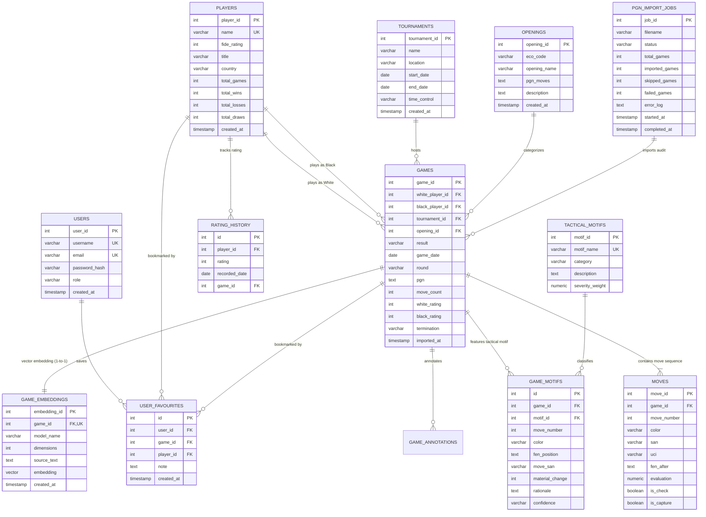

# ChessBase — A Chess Game Database & Move-Based Search Platform

> **DBMS Experiential Learning — Level 3 Project**  
> **Department of Computer Science & Engineering**

### Team Members
- **Raghav Budur** — SRN: `PES1UG23AM225`
- **Prithviraj K** — SRN: `PES1UG24AM204`

---

## 1. Problem Statement & Motivation

Millions of historical chess games are freely available in PGN (Portable Game Notation) format across platforms like Lichess, Chess.com, and FIDE archives. However, traditional database software and chess portals index games almost exclusively on surface-level metadata:
- Player names
- Tournament event and date
- Static ECO opening codes (e.g. `B90`)
- Game outcome (`1-0`, `0-1`, `1/2-1/2`)

### The Core Problem:
Conventional relational databases cannot query or index chess games based on the **tactical, strategic, and move-sequence content** of what actually transpired on the 64 squares. Queries such as:
- *"Find master games featuring a Queen Sacrifice that led to a forced checkmate attack"*
- *"Show games where Black transposed into an Accelerated Dragon with an opposite-side pawn storm"*
- *"Display games that reached this exact piece placement regardless of move order (transpositions)"*

are fundamentally impossible in standard CRUD databases without full board state reconstruction, combinatorial motif detection, and high-dimensional semantic search.

---

## 2. System Architecture & Dual-Paradigm Database Design

ChessBase implements an original **Dual-Paradigm Database Architecture** pairing PostgreSQL (Relational + Full-Text Search) with `pgvector` (Vector Database):

```
+-----------------------------------------------------------------------------------+
|                                 Next.js 14 Frontend                               |
|  - Database Cockpit (/database)       - Interactive Board Replay (/games/[id])    |
|  - Master Games Explorer (/games)     - Analysis & Input Board (/analysis)        |
|  - Opening ECO Explorer (/openings)   - Hybrid Semantic Search (/search)          |
|  - Player Career Analytics (/players) - 12 SQL Diagnostic Reports (/reports)      |
+-----------------------------------------------------------------------------------+
                                          |
                                          | REST API Routes (JSON / Parameterized)
                                          v
+-----------------------------------------------------------------------------------+
|                             Next.js API & Backend Layer                           |
|  - Tactical Fingerprint Engine (Deterministic Rules-Based Evaluator)              |
|  - ECO Move Sequence Classifier (Regex & Deep Move Hierarchy)                     |
|  - JWT Authentication & RBAC (Admin vs Player)                                    |
|  - Ingestion Engine (Transaction-Wrapped PGN Parser)                              |
+-----------------------------------------------------------------------------------+
                    |                                           |
                    | ACID Relational Pool                      | HNSW Vector Search
                    v                                           v
+---------------------------------------+   +---------------------------------------+
|        PostgreSQL 16 Relational       |   |       pgvector Extension (HNSW)       |
|  - 10 Tables with Strict Constraints  |   |  - 384-dimensional Normalized Vectors |
|  - Cascading Foreign Keys             |   |  - Cosine Distance Metric (<=>)       |
|  - Automatic Triggers (Stats Sync)    |   |  - Sub-millisecond ANN Similarity     |
|  - Stored Functions & Procedures      |   |  - Semantic Tactical Descriptions     |
|  - Views for Analytical Aggregation   |   |                                       |
|  - GIN Indexes (pg_trgm & tsvector)   |   |                                       |
+---------------------------------------+   +---------------------------------------+
```

---

## 3. Entity-Relationship (ER) Diagram



---

## 3.1 Chen / Classical Entity-Relationship (ER) Diagram (Entities, Attributes & Diamond Relationships)

The diagram below represents the conceptual database design following Chen's notation conventions (Rectangular Entities, Diamond Relationships with Cardinalities like 1:N / M:N, and Oval/Rounded Attributes including Primary Keys with underlines and Foreign Keys):

```mermaid
flowchart TD
    %% Styling Classes
    classDef entity fill:#1e293b,stroke:#38bdf8,stroke-width:2px,color:#f8fafc;
    classDef rel fill:#0f172a,stroke:#f59e0b,stroke-width:2px,color:#fbbf24;
    classDef attr fill:#0f172a,stroke:#94a3b8,stroke-dasharray: 2 2,color:#cbd5e1;
    classDef pk fill:#0f172a,stroke:#38bdf8,stroke-width:2px,color:#38bdf8;
    classDef fk fill:#0f172a,stroke:#a855f7,stroke-width:1px,color:#c084fc;

    %% Entities
    E_USERS["USERS"]:::entity
    E_PLAYERS["PLAYERS"]:::entity
    E_TOURNAMENTS["TOURNAMENTS"]:::entity
    E_OPENINGS["OPENINGS"]:::entity
    E_GAMES["GAMES"]:::entity
    E_MOVES["MOVES"]:::entity
    E_TACTICAL_MOTIFS["TACTICAL_MOTIFS"]:::entity
    E_GAME_MOTIFS["GAME_MOTIFS"]:::entity
    E_GAME_EMBEDDINGS["GAME_EMBEDDINGS"]:::entity
    E_USER_FAVOURITES["USER_FAVOURITES"]:::entity
    E_RATING_HISTORY["RATING_HISTORY"]:::entity
    E_PGN_IMPORT_JOBS["PGN_IMPORT_JOBS"]:::entity

    %% Attributes - USERS
    U_id(["<u>user_id (PK)</u>"]):::pk
    U_name(["username"]):::attr
    U_email(["email"]):::attr
    U_role(["role"]):::attr
    E_USERS --- U_id
    E_USERS --- U_name
    E_USERS --- U_email
    E_USERS --- U_role

    %% Attributes - PLAYERS
    P_id(["<u>player_id (PK)</u>"]):::pk
    P_name(["name"]):::attr
    P_fide(["fide_rating"]):::attr
    P_country(["country"]):::attr
    P_stats(["stats (wins/losses/draws)"]):::attr
    E_PLAYERS --- P_id
    E_PLAYERS --- P_name
    E_PLAYERS --- P_fide
    E_PLAYERS --- P_country
    E_PLAYERS --- P_stats

    %% Attributes - TOURNAMENTS
    T_id(["<u>tournament_id (PK)</u>"]):::pk
    T_name(["name"]):::attr
    T_loc(["location"]):::attr
    T_dates(["start_date / end_date"]):::attr
    E_TOURNAMENTS --- T_id
    E_TOURNAMENTS --- T_name
    E_TOURNAMENTS --- T_loc
    E_TOURNAMENTS --- T_dates

    %% Attributes - OPENINGS
    O_id(["<u>opening_id (PK)</u>"]):::pk
    O_eco(["eco_code"]):::attr
    O_name(["opening_name"]):::attr
    O_moves(["pgn_moves"]):::attr
    E_OPENINGS --- O_id
    E_OPENINGS --- O_eco
    E_OPENINGS --- O_name
    E_OPENINGS --- O_moves

    %% Attributes - GAMES
    G_id(["<u>game_id (PK)</u>"]):::pk
    G_res(["result"]):::attr
    G_pgn(["pgn"]):::attr
    G_cnt(["move_count"]):::attr
    G_wfk(["white_player_id (FK)"]):::fk
    G_bfk(["black_player_id (FK)"]):::fk
    G_ofk(["opening_id (FK)"]):::fk
    G_tfk(["tournament_id (FK)"]):::fk
    E_GAMES --- G_id
    E_GAMES --- G_res
    E_GAMES --- G_pgn
    E_GAMES --- G_cnt
    E_GAMES --- G_wfk
    E_GAMES --- G_bfk
    E_GAMES --- G_ofk
    E_GAMES --- G_tfk

    %% Attributes - MOVES
    M_id(["<u>move_id (PK)</u>"]):::pk
    M_num(["move_number"]):::attr
    M_col(["color"]):::attr
    M_san(["san"]):::attr
    M_fen(["fen_after"]):::attr
    M_eval(["evaluation"]):::attr
    E_MOVES --- M_id
    E_MOVES --- M_num
    E_MOVES --- M_col
    E_MOVES --- M_san
    E_MOVES --- M_fen
    E_MOVES --- M_eval

    %% Attributes - TACTICAL_MOTIFS
    TM_id(["<u>motif_id (PK)</u>"]):::pk
    TM_name(["motif_name"]):::attr
    TM_cat(["category"]):::attr
    TM_sev(["severity_weight"]):::attr
    E_TACTICAL_MOTIFS --- TM_id
    E_TACTICAL_MOTIFS --- TM_name
    E_TACTICAL_MOTIFS --- TM_cat
    E_TACTICAL_MOTIFS --- TM_sev

    %% Attributes - GAME_MOTIFS
    GM_id(["<u>id (PK)</u>"]):::pk
    GM_fen(["fen_position"]):::attr
    GM_san(["move_san"]):::attr
    GM_rat(["rationale"]):::attr
    GM_conf(["confidence"]):::attr
    E_GAME_MOTIFS --- GM_id
    E_GAME_MOTIFS --- GM_fen
    E_GAME_MOTIFS --- GM_san
    E_GAME_MOTIFS --- GM_rat
    E_GAME_MOTIFS --- GM_conf

    %% Attributes - GAME_EMBEDDINGS
    GE_id(["<u>embedding_id (PK)</u>"]):::pk
    GE_dim(["dimensions (384)"]):::attr
    GE_vec(["embedding (vector)"]):::attr
    GE_mod(["model_name"]):::attr
    E_GAME_EMBEDDINGS --- GE_id
    E_GAME_EMBEDDINGS --- GE_dim
    E_GAME_EMBEDDINGS --- GE_vec
    E_GAME_EMBEDDINGS --- GE_mod

    %% Relationships (Diamonds) with Cardinalities
    R_WHITE{"plays_white"}:::rel
    R_BLACK{"plays_black"}:::rel
    R_HOSTS{"hosts"}:::rel
    R_CATEGORIZES{"categorizes"}:::rel
    R_CONTAINS{"contains"}:::rel
    R_FEATURES{"features"}:::rel
    R_CLASSIFIES{"classifies"}:::rel
    R_HAS_EMBED{"has_embedding"}:::rel
    R_FAV_GAME{"bookmarks_game"}:::rel
    R_FAV_PLAYER{"bookmarks_player"}:::rel
    R_TRACKS{"tracks_rating"}:::rel
    R_LOGS{"imported_via"}:::rel

    %% Connections with Cardinality Notations
    E_PLAYERS ---|1| R_WHITE
    R_WHITE ---|N| E_GAMES

    E_PLAYERS ---|1| R_BLACK
    R_BLACK ---|N| E_GAMES

    E_TOURNAMENTS ---|1| R_HOSTS
    R_HOSTS ---|N| E_GAMES

    E_OPENINGS ---|1| R_CATEGORIZES
    R_CATEGORIZES ---|N| E_GAMES

    E_GAMES ---|1| R_CONTAINS
    R_CONTAINS ---|N| E_MOVES

    E_GAMES ---|1| R_FEATURES
    R_FEATURES ---|N| E_GAME_MOTIFS

    E_TACTICAL_MOTIFS ---|1| R_CLASSIFIES
    R_CLASSIFIES ---|N| E_GAME_MOTIFS

    E_GAMES ---|1| R_HAS_EMBED
    R_HAS_EMBED ---|1| E_GAME_EMBEDDINGS

    E_USERS ---|1| R_FAV_GAME
    R_FAV_GAME ---|N| E_USER_FAVOURITES
    E_USER_FAVOURITES ---|N| E_GAMES

    E_USERS ---|1| R_FAV_PLAYER
    R_FAV_PLAYER ---|N| E_USER_FAVOURITES
    E_USER_FAVOURITES ---|N| E_PLAYERS

    E_PLAYERS ---|1| R_TRACKS
    R_TRACKS ---|N| E_RATING_HISTORY

    E_PGN_IMPORT_JOBS ---|1| R_LOGS
    R_LOGS ---|N| E_GAMES
```



---

### 1. Deterministic Tactical Fingerprint Engine
Instead of black-box ML or generic heuristic labels, the engine uses **rigorous board-state reconstruction**:
- Replays full move history with accurate en-passant, castling rights, promotion, and check status.
- Evaluates true material balance differences between consecutive positions.
- Differentiates standard captures/exchanges from genuine **Queen Sacrifices**, **Exchange Sacrifices**, and **Minor Piece Sacrifices**.
- Verified with comprehensive automated test suites (`tests/tactical-fingerprint.test.ts`, `tests/tactical-motif-rigorous.test.ts`).

### 2. Dual-Paradigm Hybrid Search (SQL + Vector)
- **Vector Search:** Converts game move sequences, openings, and tactical motifs into unit-normalized 384-dimensional embeddings stored in `game_embeddings`.
- **HNSW Index:** Uses Hierarchical Navigable Small World graphs (`vector_cosine_ops`) for sub-millisecond retrieval.
- **Hybrid Scoring:** Combines cosine similarity with exact SQL filtering (player name, rating range, ECO code, game outcome) and tactical motif bonus multipliers.

### 3. Database Cockpit with Live Opening Tree & Position Matching
- Reconstructs FEN on every piece drop or move step.
- Queries `moves.fen_after` across the database to detect **identical positions and transpositions** in real-time.
- Dynamically computes the **Opening Tree & Stats** for all candidate moves (Games played, Win %, Average Elo, Repertoire share %).
- Live Stockfish evaluation and deterministic line simulator.

### 4. Advanced PostgreSQL Features Implemented
- **Automated Triggers:** `trg_update_player_stats_fn()` maintains `players` win/loss/draw counts and `total_games` automatically on game `INSERT`, `UPDATE`, or `DELETE`.
- **Rating History Tracking:** `trg_track_rating_history_fn()` automatically records player historical ratings on every game entry.
- **Stored Functions & Procedures:** `get_player_stats()`, `refresh_player_aggregates()`, `search_similar_games()`.
- **Analytical Views:** `game_summary` and `player_statistics` join complex multi-table relationships for optimized UI presentation.
- **GIN & Trigram Indexes:** `pg_trgm` fuzzy trigram indexes on player and opening names, and full-text tsvector indexes on game descriptions.

### 5. Full CRUD & Move Explorer Controls
- **Create:** Interactive board and PGN paste modal to save new games.
- **Read:** Master Games Explorer with pagination and filters; deep Replay view with algebraic notation.
- **Update:** Inline editing of game metadata (players, ratings, tournament, result, ECO code).
- **Delete:** Cascade deletion removing games, moves, motifs, embeddings, and rating history with a single click.

---

## 5. Prerequisites & Dependencies

### Prerequisites
- **Docker Desktop** (for PostgreSQL 16 + pgvector)
- **Node.js 18+ / 20+** and **npm**

---

## 6. How to Run Locally

Follow these 4 simple steps to set up and run the project locally:

```powershell
# 1. Start the PostgreSQL 16 with pgvector database container
docker compose up -d

# 2. Initialize the database schema, functions, triggers, views, and indexes
npm run db:init

# 3. Seed master tactical motifs, default admin user, and sample master games
npm run db:seed

# 4. Start the Next.js development server
npm run dev
```

Open **[http://localhost:3000](http://localhost:3000)** in your web browser.

---

## 7. Default Credentials for Evaluation

| Role | Email | Password |
|---|---|---|
| **Admin** | `admin@chessbase.local` | `AdminPassword123!` |
| **Player / User** | `player@chessbase.local` | `PlayerPassword123!` |

---

## 8. Automated Testing & Verification

Run the test suite to verify data validation, PGN parsing, vector search, and tactical motif detection:

```powershell
# Run all Vitest unit and integration tests
npm run test
```

---

## 9. Project Directory Structure

```
├── docker-compose.yml          # Container configuration (PostgreSQL 16 + pgvector)
├── package.json                # Project dependencies and operational scripts
├── .env.example                # Sample environment configuration template
├── README.md                   # Complete project documentation & guide
│
├── sql/                        # Declarative PostgreSQL DDL & Logic
│   ├── schema.sql              # Relational schema (tables, constraints, foreign keys)
│   ├── functions.sql           # Stored functions and procedures
│   ├── triggers.sql            # Event triggers for player stats and rating history
│   ├── views.sql               # Analytical views (game_summary, player_statistics)
│   └── indexes.sql             # B-tree, GIN trigram, tsvector, and HNSW vector indexes
│
├── src/
│   ├── app/                    # Next.js App Router (Pages & API Routes)
│   │   ├── page.tsx            # Home / Dashboard summary
│   │   ├── database/           # Database Cockpit (Live Board + Opening Tree + Position Matching)
│   │   ├── games/              # Master Games Explorer (with Edit/Delete operations)
│   │   │   └── [id]/           # Move-by-move visual game replay & motif inspector
│   │   ├── analysis/           # Interactive Analysis & PGN Input Board
│   │   ├── openings/           # Opening Repertoire Tree (ECO codes & win rates)
│   │   ├── players/            # Player Career Analytics & Rating History
│   │   ├── search/             # Hybrid Semantic & Relational Search
│   │   ├── reports/            # 12 Complex SQL Analytical Reports
│   │   ├── admin/              # Admin Ingestion & Job Audit Panel
│   │   └── api/                # REST API backend route handlers
│   │
│   ├── lib/
│   │   ├── db.ts               # PostgreSQL connection pool & transaction helper
│   │   └── chess/
│   │       ├── pgn-parser.ts   # PGN parser with move validation
│   │       ├── eco-classifier.ts # Deterministic ECO opening classification
│   │       ├── tactical-fingerprint.ts # Rules-based Tactical Fingerprint Engine
│   │       └── vector-search.ts # Embedding generator & pgvector query client
│   │
│   └── components/             # Reusable UI widgets and navigation
│
├── scripts/                    # Database CLI management utilities
│   ├── db-init.js              # Initializes schema, triggers, views, and indexes
│   ├── db-seed.js              # Seeds admin, tactical motifs, and master games
│   ├── clear-games.js          # Resets all game data cleanly
│   ├── repair-pgn.js           # PGN normalization and ECO classifier utility
│   └── reanalyze-games.js      # Batch re-evaluator for tactical motifs
│
├── data/                       # Datasets
│   ├── sample-games.pgn        # Initial sample historical games
│   └── repaired_games.pgn      # Verified benchmark games
│
└── tests/                      # Automated Vitest test specifications
    ├── pgn-parser.test.ts
    ├── tactical-fingerprint.test.ts
    ├── tactical-motif-rigorous.test.ts
    └── vector-search.test.ts
```
