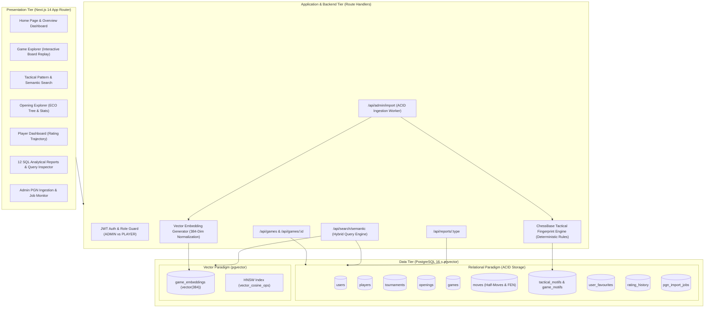

# ChessBase — System Architecture & Design Specification

**Project Title:** ChessBase — A Chess Game Database & Move-Based Search Platform  
**Course:** DBMS Experiential Learning — Level 3 Project  
**Authors:** Raghav Budur (`PES1UG23AM225`) & Prithviraj K (`PES1UG24AM204`)  

---

## 1. System Overview and Architectural Paradigm

ChessBase implements a **Dual-Paradigm Database Architecture** designed to address the fundamental limitation of traditional chess software: existing platforms index games purely on metadata (player names, dates, ECO codes, and final results), completely failing to query games based on the actual move content, strategic themes, and tactical motifs played on the 64 squares.

To solve this problem cleanly without introducing architectural bloat:
1. **Relational Database Management System (PostgreSQL):** Governs structured entities with strict ACID guarantees, foreign-key referential integrity, indexes, views, triggers, and stored functions.
2. **Vector Similarity Store (PostgreSQL with `pgvector` extension):** Stores 384-dimensional unit-normalized embeddings of move sequences, opening narratives, and strategic commentary, allowing cosine similarity retrieval (`<=>`) on natural language concepts such as *"queen sacrifice leading to a mating attack"*.



---

## 2. Query Flow: Hybrid Search Pipeline

When a user submits a query such as:
> *"Queen sacrifice followed by a mating attack in the Sicilian Defense"*

The system executes the following hybrid ranking sequence:
1. **Query Embedding Generation:** The input prompt is transformed by `VectorEngine.generateEmbedding(text)` into a 384-dimensional unit-normalized vector `Q`.
2. **Vector Candidate Retrieval:** PostgreSQL computes the cosine distance using `pgvector`:
   ```sql
   SELECT g.game_id, (ge.embedding <=> $1::vector) AS cosine_distance
   FROM game_embeddings ge
   JOIN games g ON ge.game_id = g.game_id
   ORDER BY cosine_distance ASC
   LIMIT 50;
   ```
3. **Structured Relational Filtering:** Exact relational criteria are applied simultaneously in SQL (`o.eco_code = 'B90'`, rating ranges, and player names).
4. **Deterministic Motif Correlation:** If a specific tactical motif was requested or detected (e.g. `'Queen Sacrifice'`), a 25% score boost is awarded.
5. **Composite Hybrid Ranking Formula:**
   $$\text{Score} = 0.60 \times (1.0 - \text{CosineDistance}) + 0.25 \times \text{MotifMatchBonus} + 0.15 \times \left(\frac{\min(\text{AvgRating}, 2800)}{2800}\right)$$
6. **Data Hydration & Display:** The top ranked game IDs are joined back to `players`, `tournaments`, and `openings` to populate the Game Explorer.

---

## 3. Database Choice Justification

### 3.1 Why PostgreSQL for Structured Relational Data?
Chess data exhibits strict relational properties:
- Every game has exactly two players (`white_player_id` and `black_player_id`) referencing the `players` table.
- Games reference a single opening (`openings.opening_id`) and tournament (`tournaments.tournament_id`).
- Games consist of an ordered sequence of half-moves (`moves.game_id`, `move_number`, `color`).
- Referential integrity must be guaranteed via `FOREIGN KEY ... ON DELETE CASCADE` or `RESTRICT`.
- Aggregations (`GROUP BY`, `HAVING`, `DENSE_RANK()`, `FILTER`) are required to generate live player leaderboards, color advantage statistics, and opening success rates.

### 3.2 Why `pgvector` instead of External Vector Databases (Pinecone/Qdrant)?
1. **Unified ACID Transactions:** When an admin imports a PGN file, games, moves, tactical motifs, and vector embeddings are committed within a single database transaction (`withTransaction`). If an error occurs, the vector embedding and the game record roll back together, preventing dangling vector IDs.
2. **Single Infrastructure Footprint:** No external vector SaaS API keys, zero cloud egress latency, and no synchronization drift between an external vector index and the primary database.
3. **Single SQL Query Joins:** A single SQL query can join relational filters (`rating > 2600`) with vector similarity distance (`ORDER BY embedding <=> query_vector`).

