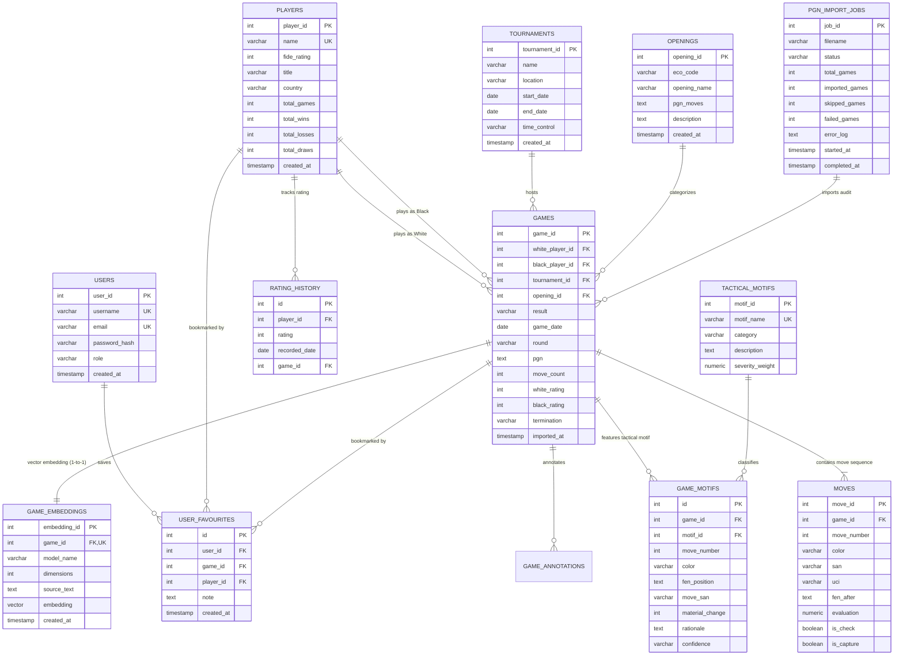

# ChessBase — Entity-Relationship (ER) Diagram & Schema Specification

**Project Title:** ChessBase — A Chess Game Database & Move-Based Search Platform  
**Course:** DBMS Experiential Learning — Level 3 Project  
**Authors:** Raghav Budur (`PES1UG23AM225`) & Prithviraj K (`PES1UG24AM204`)  

---

## 1. Visual Entity-Relationship Diagram (Crow's Foot Notation)



---

## 2. Relational Schema Data Dictionary

### 2.1 Table: `players`
- **Primary Key:** `player_id` (`SERIAL`)
- **Unique Constraint:** `name` (`VARCHAR(100)`)
- **Check Constraints:** `fide_rating >= 0`, `total_games >= 0`, `total_wins >= 0`, `total_losses >= 0`, `total_draws >= 0`
- **Audit Columns:** `created_at`
- **Indexes:** B-tree on `name`, GIN trigram index `idx_players_name_trgm` on `name` using `gin_trgm_ops`.

### 2.2 Table: `games`
- **Primary Key:** `game_id` (`SERIAL`)
- **Foreign Keys:**
  - `white_player_id -> players(player_id) ON DELETE RESTRICT`
  - `black_player_id -> players(player_id) ON DELETE RESTRICT`
  - `tournament_id -> tournaments(tournament_id) ON DELETE SET NULL`
  - `opening_id -> openings(opening_id) ON DELETE SET NULL`
- **Check Constraints:**
  - `white_player_id <> black_player_id` (Ensures player cannot play against themselves)
  - `result IN ('1-0', '0-1', '1/2-1/2', '*')`
  - `move_count >= 0`, `white_rating >= 0`, `black_rating >= 0`
- **Indexes:** B-tree on `white_player_id`, `black_player_id`, `tournament_id`, `opening_id`, `result`, `game_date`.

### 2.3 Table: `moves`
- **Primary Key:** `move_id` (`SERIAL`)
- **Foreign Key:** `game_id -> games(game_id) ON DELETE CASCADE`
- **Unique Constraint:** `(game_id, move_number, color)` (Prevents duplicate half-move entries)
- **Check Constraints:** `color IN ('white', 'black')`
- **Replay Data:** `fen_after` (full Forsyth–Edwards Notation after move execution), `san` (Standard Algebraic Notation), `uci` (Universal Chess Interface coordinate).

### 2.4 Table: `game_motifs`
- **Primary Key:** `id` (`SERIAL`)
- **Foreign Keys:**
  - `game_id -> games(game_id) ON DELETE CASCADE`
  - `motif_id -> tactical_motifs(motif_id) ON DELETE CASCADE`
- **Unique Constraint:** `(game_id, motif_id, move_number, color)`
- **Check Constraints:** `confidence IN ('EXACT', 'RULE_BASED', 'HEURISTIC')`

### 2.5 Table: `game_embeddings` (Vector Database Paradigm)
- **Primary Key:** `embedding_id` (`SERIAL`)
- **Foreign Key / Unique:** `game_id -> games(game_id) ON DELETE CASCADE` (1-to-1 relationship)
- **Vector Column:** `embedding vector(384) NOT NULL`
- **Vector Index:** Hierarchical Navigable Small World (`HNSW`) index:
  ```sql
  CREATE INDEX idx_game_embeddings_vector_hnsw 
  ON game_embeddings 
  USING hnsw (embedding vector_cosine_ops)
  WITH (m = 16, ef_construction = 64);
  ```

