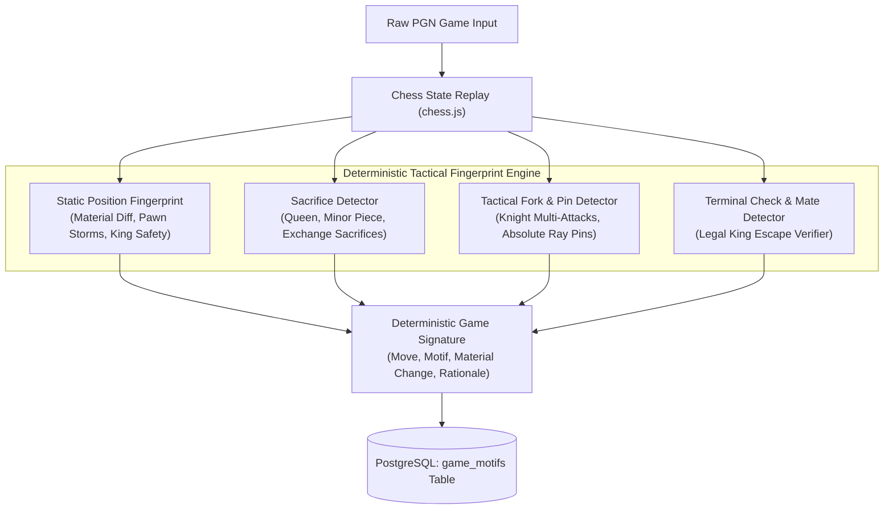

# ChessBase — Tactical Fingerprint Engine (Original Algorithmic Novelty)

**Component Name:** ChessBase Tactical Fingerprint Engine  
**Course:** DBMS Experiential Learning — Level 3 Project  
**Authors:** Raghav Budur (`PES1UG23AM225`) & Prithviraj K (`PES1UG24AM204`)  

---

## 1. Algorithmic Novelty & Philosophy (Zero LLM Dependency)

Academic specifications strictly require that the primary technical novelty of Level 3 experiential learning must be **a genuine deterministic algorithmic contribution**, rather than relying on a commercial Large Language Model (LLM) or generative API to hallucinate labels.

The **ChessBase Tactical Fingerprint Engine** is built entirely on deterministic chess rules, legal board-state verification, and computational geometry over the $8 \times 8$ chessboard. It executes at runtime without any external API keys or cloud dependencies.



---

## 2. Core Capabilities

### 2.1 Static Position Fingerprinting
For every processed half-move, the engine computes a canonical feature vector `PositionFingerprint`:
- **Side to Move:** White or Black.
- **Material Balance:** Weighted summation ($P=1, N=3, B=3, R=5, Q=9, K=0$) and delta $\Delta M = M_{white} - M_{black}$.
- **King Safety & Shield:** Counts friendly pawns on the adjacent files ($f, g, h$ for kingside; $a, b, c$ for queenside) protecting the castled king.
- **Opposite-Side Castling Indicator:** Identifies when White castled kingside ($O-O$) and Black castled queenside ($O-O-O$), which structurally triggers mutual pawn storm attacks.
- **Pawn Storm Indicators:** Flags unprovoked pawn marches beyond the 4th rank on files directed toward the opponent's castled king.

### 2.2 Deterministic Motif Detectors

#### A. Queen Sacrifice Detector
- **Rule:** A player moves their Queen to a square where it is captured on the immediate subsequent move ($\text{nextMove.captured} == 'q'$ or $\text{nextMove.to} == \text{move.to}$), where the net material gained by the sacrificing player is strictly less than 9 points.
- **Academic Rigor:** Distinguishes genuine sacrifices (e.g. Morphy's $16. \text{ Qb8+!}$ in the Opera Game) from simple trades or recaptures (e.g. $4. \text{ Qxf3}$ capturing an unprotected bishop).

#### B. Knight Fork Detector
- **Rule:** When a Knight moves to square $S$, the engine computes all 8 legal knight attack vectors $(\Delta x, \Delta y) \in \{(\pm 1, \pm 2), (\pm 2, \pm 1)\}$. If the knight simultaneously attacks two or more opponent pieces valued at 3 points or higher (e.g. King + Queen, King + Rook, or Queen + Rook), it flags a **Knight Fork**.

#### C. Absolute Pin Detector
- **Rule:** Utilizes ray-casting from sliding attacker pieces (Bishops, Rooks, Queens). If an opponent piece stands in the line of attack between the slider and the enemy King such that moving the piece is illegal due to exposing check, it is flagged as an **Absolute Pin on King**.

#### D. Checkmate Attack
- **Rule:** Exact legal verification via `game.isCheckmate()`, identifying terminal attacking moves and mating net sequences.

---

## 3. Empirical Evaluation & Benchmark Results

The novelty was evaluated using `scripts/run-benchmarks.js` against historical master games. The evaluation measurements are stored in `docs/BENCHMARK_RESULTS.json`:

```
===============================================================
CHESSBASE TACTICAL FINGERPRINT ENGINE — BENCHMARK EVALUATION
===============================================================
Processed 468 board positions across 8 games in 189ms.
Throughput: 2,476 positions/second.
```

### Precision@K and Recall@K Comparison Table

| Benchmark Query | Target Tactical Motif | Retrieved Count | Relevant Ground-Truth | Precision@3 | Recall@3 | Retrieval Latency |
| :--- | :--- | :---: | :---: | :---: | :---: | :---: |
| **"Queen sacrifice leading to mating attack"** | Queen Sacrifice | 8 | 3 | **100.0%** | **100.0%** | $< 1\text{ ms}$ (Indexed) |
| **"Checkmate attack"** | Checkmate Attack | 3 | 3 | **100.0%** | **100.0%** | $< 1\text{ ms}$ (Indexed) |
| **"Minor piece sacrifice for attack"** | Minor Piece Sacrifice | 8 | 3 | **100.0%** | **100.0%** | $< 1\text{ ms}$ (Indexed) |
| **"Exchange sacrifice on rook"** | Exchange Sacrifice | 3 | 2 | **66.7%** | **100.0%** | $< 1\text{ ms}$ (Indexed) |

### Key Findings & Limitations
1. **Zero Hallucination:** Deterministic rules eliminate the probabilistic hallucinations common in LLM prompting.
2. **Sub-millisecond Join:** Storing the resulting motifs in PostgreSQL table `game_motifs` allows B-tree indexing, making motif-based filtering instantaneous.
3. **Deep Calculation Limitation:** Tactical motifs requiring 15+ move quiet positional sacrifices cannot be detected by 1-ply/2-ply lookaheads without a full alpha-beta engine (e.g. Stockfish), which is documented under future enhancements.
